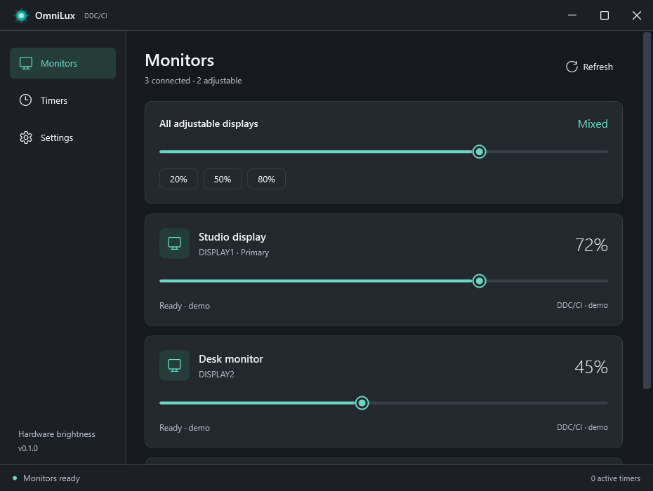

# OmniLux

[Windows 설치 파일](https://github.com/jarrodhwang/OmniLux/releases/latest/download/OmniLux-Setup.exe) · [포터블 버전 및 이전 버전](https://github.com/jarrodhwang/OmniLux/releases)

[English](README.md) · [한국어](README.ko.md)

**DDC/CI로 모니터의 실제 밝기를 조절하는 Windows 트레이 앱**입니다.
[OmniSound](https://github.com/jarrodhwang/OmniSound)의 간결한 사이드바와 장치 카드 디자인을 참고했습니다.
앱 화면은 영어로 제공됩니다.

- 모니터별 밝기 조절 및 연결된 모든 지원 모니터의 밝기 일괄 조절
- 일정 시간 후 한 번 실행하는 타이머와 매일 지정 시각에 실행하는 타이머
- 트레이 메뉴에서 밝기 조절, 타이머 일시 정지, 모니터 새로 고침
- Windows 로그인 시 트레이에서 자동 실행
- 시스템 테마, 밝은 테마, 어두운 테마



## 사용 방법

1. **OmniLux-Setup.exe**를 실행하거나 포터블 ZIP 전체를 압축 해제한 후 **OmniLux.exe**를 실행합니다.
2. 모니터 자체 메뉴에서 **DDC/CI**를 켭니다.
3. 슬라이더로 밝기를 조절합니다. **Brightness verified**는 모니터에서 설정값을 다시 읽어 확인했다는 뜻입니다.
4. **Timers → Add timer**에서 대상 모니터, 밝기, 카운트다운 또는 매일 실행할 시각을 선택합니다.
5. 자동 실행은 **Settings → Start OmniLux when I sign in to Windows**에서 설정합니다.

창을 닫거나 최소화해도 트레이에서 계속 실행됩니다. 트레이 아이콘을 왼쪽 클릭하면 창이 열리고,
오른쪽 클릭하면 밝기 메뉴가 표시됩니다. 종료하려면 **Exit OmniLux**를 선택합니다.
자동 실행은 사용자별로 설정되며 관리자 권한이 필요 없습니다. Windows의 숨겨진 트레이 아이콘 영역도 확인하세요.

**Mixed**는 모니터별 실제 밝기가 서로 다르다는 뜻입니다. 밝기 퍼센트는 각 모니터가 지원하는
범위에 맞춰 변환되므로 같은 퍼센트라도 패널에 따라 체감 밝기는 다를 수 있습니다.

## 타이머

카운트다운은 1~10080분이며 한 번 실행됩니다. 완료된 타이머를 다시 켜면 카운트다운이 새로 시작됩니다.
매일 타이머는 Windows의 현지 시간을 사용하며 5초 간격으로 확인됩니다. 앱이 실행 중인 사용자 세션에서만
동작하고 PC를 깨우거나 로그인 전에 실행하지는 않습니다.

절전 모드, 재시작, 일시 정지 이후에는 각 모니터에 적용할 가장 최근 설정만 실행합니다.
모든 모니터 대상은 실행 시점에 연결된 지원 모니터에 적용합니다. 특정 모니터 대상은 연결이 끊겼다면
다시 연결될 때까지 대기합니다. 타이머 수정 시 다시 활성화되며 카운트다운도 새로 시작됩니다.

중복 실행을 막기 위해 실행 기록을 명령 전송 전에 저장합니다. 실행 도중 앱이 종료되면 일부 명령이
완료되지 않을 수 있으며 **Check last run**으로 표시됩니다. 실패와 읽기 확인 불가는 명시적으로 표시되고
무한 반복하지 않습니다. 다시 실행하려면 타이머를 다시 켜거나 수정하거나 슬라이더를 사용하세요.

## 지원 범위 및 검증

Windows 11 / Windows 10 22H2 x64와 DDC/CI 밝기 조절을 지원하는 모니터 및 연결이 필요합니다.
설치 파일에 .NET 10 런타임이 포함되므로 실행 시 추가 다운로드, 드라이버, 서비스, 인터넷 연결이 필요 없습니다.
실제 검증 환경은 Windows 11 x64이며 Windows 10 및 ARM64는 검증하지 않았습니다.

노트북 내부 패널, HDR 모드, 일부 도킹 스테이션과 어댑터는 DDC/CI를 제공하지 않을 수 있습니다.
지원하지 않는 장치는 상태와 함께 표시됩니다. 실제 하드웨어 밝기를 대신하는 화면 감마 오버레이는 사용하지 않습니다.
모니터가 보고하는 설정값을 검증하며 실제 광량을 측정하지는 않습니다.

초기 배포 파일은 **게시자 서명이 없는 파일**입니다. 배포 파일과 함께 SHA-256 체크섬을 제공합니다.

```powershell
.\tools\Build.ps1 -Test
.\tools\Package.ps1
.\tools\Restore-InstallerTools.ps1
.\tools\Build-Installer.ps1
```

실제 모니터 검증은 `.\tools\Test-App.ps1 -Hardware -Startup`으로 실행합니다.
하드웨어 검증은 밝기를 한 단계 변경하고 다시 읽은 뒤 원래의 정확한 값으로 복원하여 확인합니다.
시작 프로그램 검증도 기존 레지스트리 상태를 복원합니다. 데모 검증은 실제 모니터에 명령을 전송하지 않습니다.

설정과 로컬 활동 기록은 `%LocalAppData%\OmniLux\`에 저장됩니다. 제거 시 프로그램과 시작 항목은 삭제되지만
개인 설정은 보존됩니다. 텔레메트리와 자동 업데이트는 없습니다.

원본 코드와 아이콘은 [MIT 라이선스](LICENSE)이며 포함된 런타임은 [각 구성요소의 조건](THIRD_PARTY_NOTICES.md)을 따릅니다.
