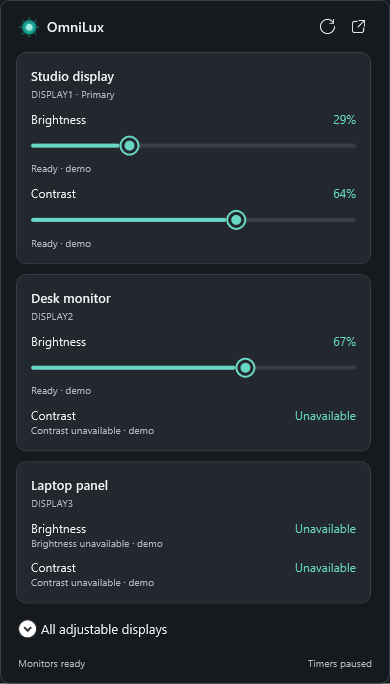

# OmniLux 0.2

[Windows 설치 파일](https://github.com/jarrodhwang/OmniLux/releases/latest/download/OmniLux-Setup.exe) · [포터블 및 이전 버전](https://github.com/jarrodhwang/OmniLux/releases) · [변경 사항](CHANGELOG.md)

[English](README.md) · [한국어](README.ko.md)

**DDC/CI로 모니터의 실제 밝기와 대비를 조절하는 Windows 트레이 앱**입니다.
[OmniSound](https://github.com/jarrodhwang/OmniSound)의 간결한 장치 카드 디자인을 참고했습니다.
앱 화면은 영어로 제공됩니다.

- 트레이 아이콘을 왼쪽 클릭하면 모니터별 밝기·대비 슬라이더가 표시됩니다. 메인 창을 열 필요가 없습니다.
- 모니터별 조절과 지원 모니터 일괄 조절을 제공합니다.
- 드래그 중에는 미리보기만 표시하고, 마우스를 놓거나 슬라이더를 벗어나면 최종 값을 적용합니다.
- 밝기 카운트다운·매일 실행 타이머, Windows 로그인 시 자동 실행, 시스템·밝은·어두운 테마를 지원합니다.



## 사용 방법

1. **OmniLux-Setup.exe**를 실행하거나 포터블 ZIP 전체를 압축 해제한 뒤 **OmniLux.exe**를 실행합니다.
2. 모니터 자체 메뉴에서 **DDC/CI**를 켭니다.
3. 트레이 아이콘을 왼쪽 클릭하고 각 모니터의 **Brightness** 또는 **Contrast** 슬라이더를 조절합니다.
4. 메인 창은 트레이 패널의 창 열기 버튼 또는 오른쪽 클릭 메뉴의 **Open OmniLux**로 엽니다.
5. 자동 실행은 **Settings → Start OmniLux when I sign in to Windows**에서 설정합니다.

마우스를 누르고 있는 동안에는 중간 값을 하드웨어로 전송하지 않습니다. 마우스를 놓으면 최종 값을 한 번 적용합니다.
드래그 중이 아닐 때 슬라이더를 벗어나도 미리보기 값이 적용됩니다. 키보드 조절은 키를 놓을 때 적용되고,
체크 버튼으로도 적용할 수 있습니다. 트레이 패널에서 **Escape**를 누르면 아직 적용하지 않은 미리보기를 취소합니다.
다른 곳을 클릭하면 패널이 닫히고 남은 미리보기가 적용됩니다. 프리셋 버튼은 즉시 적용합니다.

**Brightness verified / Contrast verified**는 모니터에서 설정값을 다시 읽어 확인했다는 뜻입니다.
밝기와 대비 지원 여부는 각각 확인하므로 대비를 지원하지 않아도 밝기는 사용할 수 있습니다.
**Mixed**는 모니터별 값이 다르다는 뜻이며, **Unavailable**은 해당 기능을 사용할 수 없다는 뜻입니다.
퍼센트는 각 모니터의 하드웨어 범위에 맞춰 변환되므로 같은 값이어도 체감 밝기가 다를 수 있습니다.

메인 창을 닫거나 최소화해도 트레이에서 계속 실행됩니다. 종료하려면 **Exit OmniLux**를 선택합니다.
업그레이드 시 설치 경로, 타이머 설정, 앱에서 변경한 자동 실행 설정을 보존합니다.

## 타이머와 지원 범위

타이머는 밝기를 대상으로 합니다. 대비는 이번 버전에서 수동 조절합니다.
카운트다운은 1~10080분이며 한 번 실행됩니다. 매일 타이머는 Windows 현지 시간을 사용하고 5초 간격으로 확인합니다.
절전·재시작·일시 정지 이후에는 각 모니터에 적용할 가장 최근 설정만 실행합니다.
특정 모니터가 연결되지 않았다면 다시 연결될 때까지 대기합니다. 앱이 실행 중인 사용자 세션에서만 동작하며
PC를 깨우거나 로그인 전에 실행하지 않습니다.

Windows 11 / Windows 10 22H2 x64와 DDC/CI를 지원하는 모니터·연결이 필요합니다.
.NET 10 런타임이 포함되어 실행 시 추가 다운로드, 드라이버, 서비스, 인터넷 연결이 필요 없습니다.
실제 검증 환경은 Windows 11 x64이며 Windows 10과 ARM64는 검증하지 않았습니다.
HDR, 화면 모드, 노트북 패널, 도킹 스테이션, 어댑터에 따라 밝기 또는 대비를 지원하지 않을 수 있습니다.
하드웨어 대신 감마 오버레이를 사용하지 않으며 실제 광량을 측정하지는 않습니다.

현재 배포 파일은 **게시자 서명이 없는 파일**입니다. 설치 파일과 포터블 ZIP의 SHA-256 체크섬을 제공합니다.

```powershell
.\tools\Build.ps1 -Test
.\tools\Package.ps1 -SkipTests
.\tools\Restore-InstallerTools.ps1
.\tools\Build-Installer.ps1
.\tools\Test-App.ps1 -Hardware -Startup
.\tools\Test-Upgrade.ps1
```

35개 핵심 회귀 테스트와 34개 WPF 데모 UI 검사를 제공합니다. 실제 모니터 검증은 지원하는 밝기·대비를
한 단계 변경해 다시 읽고 원래의 정확한 값으로 복원합니다. 시작 프로그램 검증도 기존 상태를 복원합니다.
검증 기록은 `build/validation/`에 저장하며 데모 모드는 실제 모니터에 명령을 보내지 않습니다.

설정과 로컬 활동 기록은 `%LocalAppData%\OmniLux\`에 저장됩니다. 0.1 버전 설정도 호환됩니다.
제거 시 프로그램과 시작 항목은 삭제되지만 개인 설정은 보존됩니다. 텔레메트리와 자동 업데이트는 없습니다.

원본 코드·아이콘은 [MIT 라이선스](LICENSE)이며 런타임은 [각 구성요소의 조건](THIRD_PARTY_NOTICES.md)을 따릅니다.
